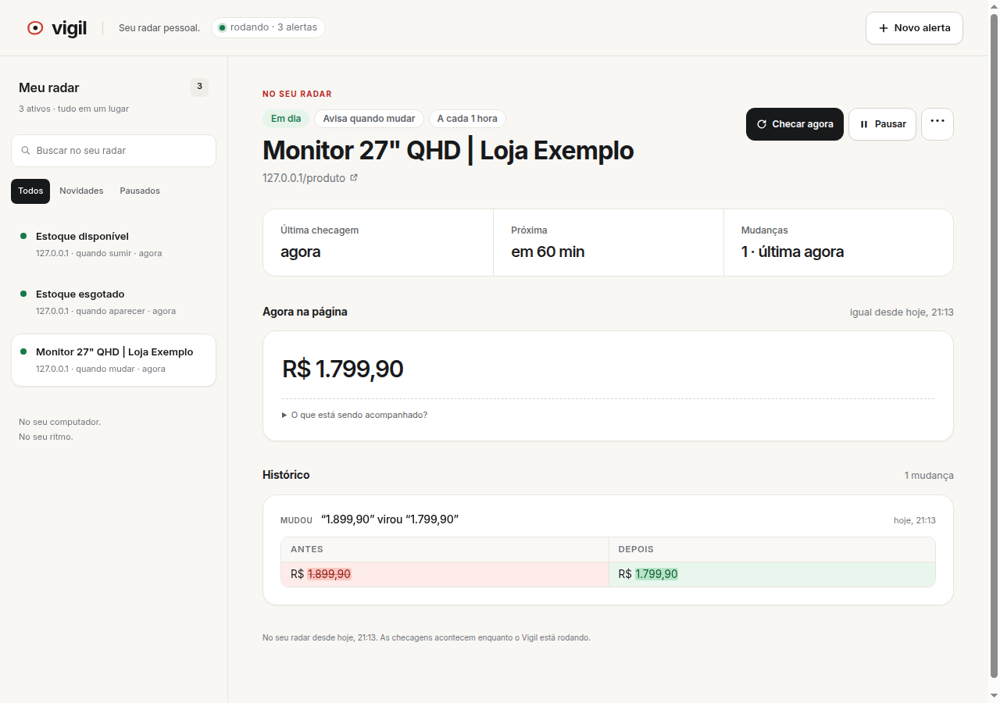

# Vigil

[](https://github.com/ArthurGoon/Vigil/actions/workflows/ci.yml)
[](https://github.com/ArthurGoon/Vigil/releases/latest)
[](LICENSE)

Monitor local de trechos de páginas. Circule um preço, uma vaga ou um aviso com a extensão do Chrome e escolha quando quer ser avisado: quando **mudar**, **aparecer** ou **sumir**. O painel mostra a leitura atual e o histórico com antes/depois; a extensão avisa no Chrome. Busca e filtros ajudam a encontrar seus alertas, e no celular a lista se recolhe para dar espaço ao que mudou.

Sem conta, chave de API, Docker ou banco externo. Um único processo Node serve o painel, agenda as checagens e guarda os dados em SQLite.



*Demonstração com dados fictícios de `fixtures/demo/produto.html`, servidos localmente. O teste ponta a ponta circula o preço com a extensão, troca R$ 1.899,90 por R$ 1.799,90 e confere o histórico.*

## Começar

Versão **2.0.0** · uso local, pessoal e portfólio. [Notas da versão](CHANGELOG.md) · [Validação](docs/VALIDACAO.md).

Precisa de **Node 22.13+** (o CI usa Node 24). Não há build.

```bash
git clone https://github.com/ArthurGoon/Vigil.git
cd Vigil
npm ci
npm start
```

Abra [localhost:3000](http://localhost:3000). Para criar sem extensão, clique em **Novo alerta**, preencha a URL e o trecho, escolha o modo e salve. No modo “mudar”, um seletor CSS restringe a comparação ao elemento inteiro; sem seletor, compara uma janela ao redor do texto.

Mantenha o processo rodando para as checagens acontecerem. Se o computador desligar ou dormir, o Vigil só volta a checar quando o processo retomar. Pare com `Ctrl+C`: ele espera as checagens em andamento antes de fechar o banco.

### Extensão do Chrome

1. Abra `chrome://extensions` e ative **Modo do desenvolvedor**.
2. Clique em **Carregar sem compactação** e escolha a pasta `extension/` do clone. Também é possível baixar e extrair o ZIP da extensão na [release v2.0.0](https://github.com/ArthurGoon/Vigil/releases/tag/v2.0.0), escolhendo a pasta extraída. O servidor Node continua necessário.
3. Com o servidor rodando, abra um site, clique no ícone da extensão e em **Circular algo nesta página**. Também há o atalho `Alt+Shift+V` e a opção no menu do botão direito.
4. Circule o trecho. O cartão mostra o que será monitorado; **Maior/Menor** ajustam o elemento.
5. Escolha mudar/aparecer/sumir e clique em **Vigiar**. A primeira leitura cria a referência, sem disparar alerta.

Antes de salvar, a extensão consulta o servidor para conferir se ele consegue ler o trecho. Isso ajuda a identificar páginas que dependem de JavaScript ou bloqueiam acesso automático. O popup permite pausar, retomar, checar agora e abrir o painel. As notificações dependem do Chrome aberto e das permissões do sistema; a extensão consulta novidades a cada minuto.

### Demonstração local

Em outro terminal, sirva as páginas fictícias:

```bash
python3 -m http.server 8080 --bind 127.0.0.1 --directory fixtures/demo
```

Abra [o produto de demonstração](http://127.0.0.1:8080/produto.html) e circule o preço. Edite o preço no HTML, depois clique em **Checar agora** no Vigil. Há também `vagas.html` para experimentar os modos de presença. Os arquivos são exemplos; não representam lojas, vagas ou clientes reais.

### Atualizar da versão anterior

A v2 substitui a arquitetura com Postgres, login e processos separados por um servidor local com SQLite. Instale esta versão em uma pasta nova e preserve o banco/configuração antigos se precisar deles. Não há migração automática de alertas do Postgres para SQLite. Se já usa a versão com SQLite, mantenha a pasta `data/` e recarregue a extensão após atualizar os arquivos.

## Dados e configuração

O banco é criado automaticamente em `data/vigil.db`, ignorado pelo Git. As migrations rodam na inicialização. Para fazer backup, pare o Vigil e copie a pasta `data/`; para restaurar, devolva essa pasta com o processo parado.

| Variável | Padrão | Uso |
|---|---|---|
| `PORT` | `3000` | Porta do painel/API |
| `VIGIL_DB` | `data/vigil.db` | Caminho do banco SQLite |
| `VIGIL_MIN_INTERVAL` | `5` | Intervalo mínimo em minutos |
| `VIGIL_CHECK_COOLDOWN` | `10` | Espera entre checagens manuais, em segundos |
| `VIGIL_CONCURRENCY` | `3` | Checagens agendadas simultâneas |
| `VIGIL_POLL_MS` | `5000` | Frequência do agendador, em milissegundos |

Exemplo: `PORT=3001 npm start`. Se trocar a porta, ajuste também **Servidor** no rodapé do popup da extensão. As variáveis são lidas do ambiente do processo; não há carregamento automático de `.env`.

A API escuta somente em `127.0.0.1`. Sem login, o acesso é destinado à própria máquina; o middleware verifica host e origem para bloquear chamadas de outros sites. Não exponha esta versão como um serviço público.

## Como funciona

```text
extensão Chrome (caneta e notificações) ─┐
                                       ├─ API Hono ─ SQLite
painel web (HTML/CSS/JS) ────────────────┘      │
                                              └─ agendador ─ fetch HTTP/2 + Cheerio
                                                                │
                                              observação ─ comparação ─ histórico
```

- **Primeira leitura como referência.** Sem alerta na criação. As leituras seguintes comparam com o último estado salvo.
- **Alerta por transição.** “Aparecer” só dispara de ausente para presente; “sumir”, de presente para ausente. Mudar outras partes da página não dispara esses modos.
- **Comparação normalizada.** Espaços, quebras de linha e caixa não geram mudanças falsas. O modo “mudar” usa o texto do seletor ou uma janela de 80 caracteres ao redor do trecho.
- **Checagem única por alerta.** O agendador e o botão manual compartilham o controle das requisições em andamento. O agendador reserva os alertas vencidos com uma atualização atômica no SQLite e um lease de 120 s.
- **Edição durante uma requisição.** Um resultado do endereço/trecho antigo não substitui a referência nem o estado de erro do novo alvo.
- **Falhas visíveis.** HTTP 404/503 e falhas de rede viram erro, sem comparar a página de erro com o trecho. O intervalo de novas tentativas cresce até 24 h (ou até o próprio intervalo, se ele for maior).
- **Retenção limitada.** Até 20 snapshots e 200 mudanças por alerta. Snapshot guarda o texto observado, não o HTML inteiro.
- **Webhook opcional.** Defina no editor uma URL que recebe um POST JSON por mudança, com uma segunda tentativa se falhar. O histórico permanece salvo mesmo se o webhook falhar.

## Testar

```bash
npm run check
npm run typecheck
npm test
npm run test:e2e
```

Os testes automatizados de backend cobrem os três modos, extração e diff, API com servidor HTTP local real, SQLite, agendamento, cooldown, edição durante requisições e criação quando já há outros alertas vencidos.

O ponta a ponta precisa de Google Chrome/Chromium; use `CHROME_PATH=/caminho/do/chrome npm run test:e2e` se necessário. Ele sobe servidor e banco temporários, usa uma página local editável, desenha com a caneta da extensão, cria os três modos, verifica o histórico, o cursor de notificações e o popup, recarrega o painel e confere busca, filtros, modos claro/escuro, navegação móvel e confirmação de exclusão com retorno do foco. Não usa o banco pessoal nem serviços externos. Imagens, logs e `checks.json` ficam na pasta temporária indicada ao terminar. A entrega visual das notificações pelo sistema operacional requer conferência manual.

O registro desta revisão está em [docs/VALIDACAO.md](docs/VALIDACAO.md).

## API local

| Método | Rota | Uso |
|---|---|---|
| GET | `/api/health` | Saúde, intervalo mínimo e novidades |
| GET, POST | `/api/watches` | Listar / criar e fazer a primeira leitura |
| GET, PATCH, DELETE | `/api/watches/:id` | Ler / editar / excluir |
| POST | `/api/watches/:id/check` | Checagem manual |
| GET | `/api/watches/:id/changes` | Histórico com diff |
| POST | `/api/watches/:id/seen` | Marcar mudanças do alerta como vistas |
| GET | `/api/changes?after=0&limit=20` | Feed de novidades |
| POST | `/api/changes/seen` | Marcar todas como vistas |
| POST | `/api/probe` | Conferir texto e seletores antes de salvar |

## Limites atuais

- O servidor lê o HTML recebido. Não executa o JavaScript do site nem usa a sessão de login do navegador. Páginas autenticadas, desafios antirobô ou conteúdo só renderizado por JavaScript podem falhar.
- Seletores podem deixar de funcionar quando um site muda de layout. No modo “mudar”, isso gera um erro visível até o alerta ser editado; os modos de presença tentam a página inteira se o seletor desaparecer.
- Sem seletor, mudanças vizinhas ao trecho também podem gerar alerta.
- Texto comparado limitado a 100 mil caracteres; timeout de 15 s e limite de HTML de 3 MB.
- Notificações dependem de Chrome e Vigil em execução. Não há fila persistente de reentrega de webhooks, sincronização entre dispositivos nem consulta a `robots.txt`.

## Estrutura

```text
src/app.ts              API e arquivos estáticos
src/index.ts            inicialização e encerramento
src/scheduler.ts        checagens agendadas
src/db/store.ts         SQLite, migrations e retenção
src/domain/             CRUD, observação, checagem e prévia
src/lib/                HTTP/HTML, diff e webhook
web/                    painel sem framework
extension/              extensão Chrome MV3
fixtures/               páginas fictícias para testes e demo
scripts/                teste ponta a ponta com Chrome
```

## Contribuir e relatar problemas

Veja [CONTRIBUTING.md](CONTRIBUTING.md). Ao abrir uma issue, informe o modo de alerta, versão do Node/Chrome e passos para reproduzir. Prefira exemplos públicos ou as fixtures, sem incluir dados pessoais.

## Licença

Código sob [MIT](LICENSE). A fonte Inter incluída usa a [SIL Open Font License](web/fonts/OFL.txt).
